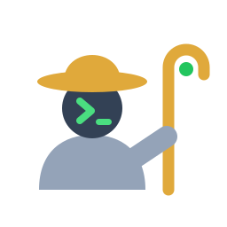

<p align="center">
  
</p>

<h1 align="center">shep</h1>

<p align="center">SSH hosts for humans and agents.</p>

<p align="center">
  <a href="https://github.com/hsd2514/shep/actions/workflows/ci.yml"></a>
  
  
  
  
  
</p>

`shep` (short for shepherd) sits on top of your normal `~/.ssh/config`, so plain `ssh` and every other tool keep working, and adds what coding agents need: commands that never prompt, JSON output, per-host rules and a log of what was run.

It never stores keys or passwords. Authentication is left to `ssh` and your ssh-agent.

## Quick start

1. **Install.** You need Go 1.25 or newer:

   ```
   go install github.com/hsd2514/shep@latest
   ```

   This puts `shep` in your Go bin folder (`%USERPROFILE%\go\bin` on Windows, `~/go/bin` elsewhere), which the Go installer adds to PATH. Open a new terminal afterwards. From a clone of this repo, `go install .` does the same.

2. **See your hosts.** Anything already in `~/.ssh/config` shows up, read-only by default:

   ```
   shep list
   ```

3. **Add a host**, with a tag and a note so agents know what it is:

   ```
   shep add api --host 203.0.113.10 --user deploy --key ~/.ssh/id_work --tags work --note "staging API"
   ```

4. **Connect once yourself** to accept the server fingerprint, since agents cannot answer that prompt:

   ```
   shep connect api
   ```

5. **Check that it works without prompts:**

   ```
   shep check api
   ```

6. **Decide what agents may do there** (`blocked`, `readonly` or `full`):

   ```
   shep set api --policy readonly
   ```

7. **Tell your agent about shep.** Paste the output of this into `CLAUDE.md` or `AGENTS.md`:

   ```
   shep guide
   ```

8. **Review what agents ran:**

   ```
   shep log
   ```

## For agents

```
shep list --json
shep show <host> --json
shep check <host> --json
shep run --json <host> <command>
shep log --json
```

`shep guide` prints a section to paste into `CLAUDE.md` or `AGENTS.md`.

## For you

These only run in an interactive terminal, so an agent cannot change its own rules.

```
shep add api --host 203.0.113.10 --user deploy --key ~/.ssh/id_work --tags work --policy readonly --note "staging API"
shep set api --policy full
shep set api --allow "docker compose restart"
shep rm api
shep connect api
shep scope personal
```

## Policies

| Policy | What agents can run |
|---|---|
| `blocked` | Nothing |
| `readonly` (default) | Allow-listed read-only commands (`ls`, `cat`, `df`, `ps`, `docker ps`, `systemctl status`, ...). Pipes are fine; `;`, `&&`, redirection and `$` are refused. Add more per host with `--allow`. |
| `full` | Anything |

## Scopes

Tag hosts (`--tags work`), then set `SHEP_SCOPE=work` in the terminal an agent runs in. It will only see hosts with that tag. `shep scope <name>` sets the default for terminals where the variable is not set.

## Limits

- `readonly` filters the command text; it is not a sandbox. The real limit is what the remote user may do, so give agents a non-root account.
- Rules and scopes only apply to commands that go through `shep`. Deny `ssh` in the agent's own permission settings to make them stick.
- `Include` files and `Match` blocks in the SSH config are not read.

## Files

- `~/.ssh/config`: hosts. Backed up to `config.shep-bak-*` before every edit (newest 10 kept).
- `~/.shep/shep.json`: tags, policies and notes.
- `~/.shep/audit.jsonl`: every command run or refused.
